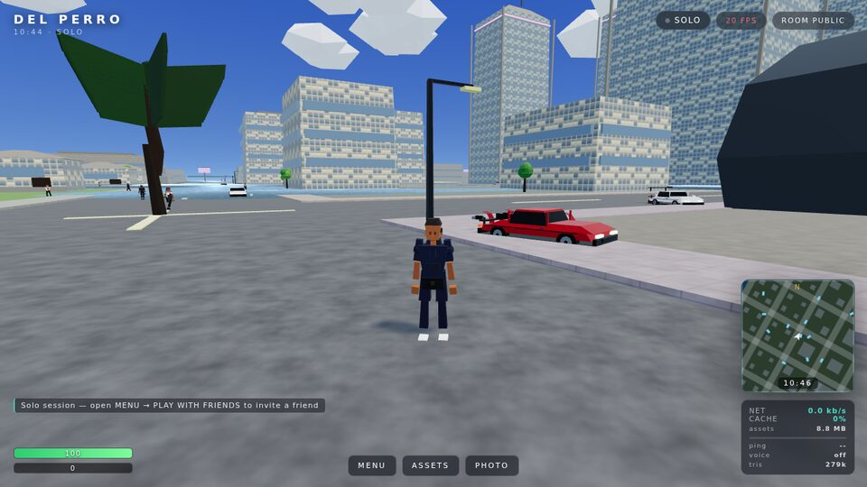
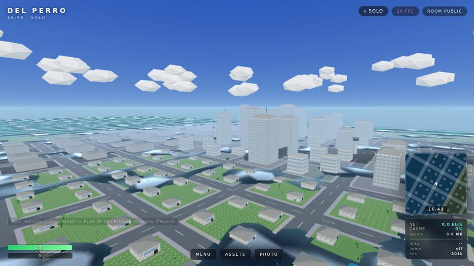
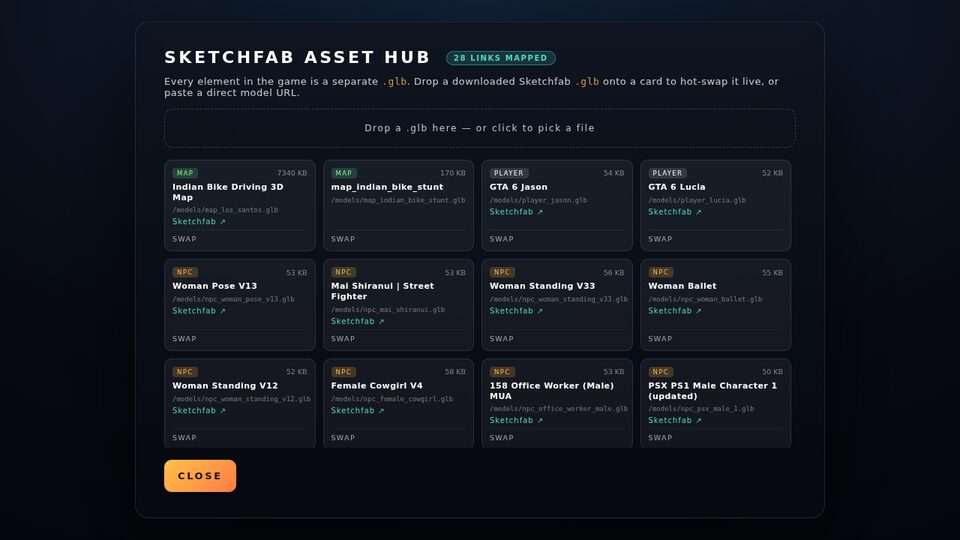
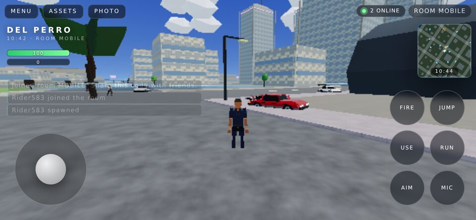

# LOS SANTOS — low-poly third-person open world (Three.js / WebGL)

A GTA-V-inspired open-world action game that runs in the browser on desktop **and**
mobile. Coastline, downtown towers, palm-tree suburbs, a highway loop, an airport with
helipads, drivable traffic, aircraft, weapons, 13 NPC archetypes — all built from
separate `.glb` assets — plus real-time multiplayer with **voice chat** over a
**very low-bandwidth** binary netcode.

```
npm install          # installs deps + syncs the three.js vendor files
npm run build        # regenerates every .glb asset, bundles the client into dist/
npm start            # http://localhost:3000  (serve dist/ + public/)
```

Open the URL on your phone (same Wi-Fi, use `http://<lan-ip>:3000`) for the touch build.




| Sketchfab asset hub | Phone / touch build |
|---|---|
|  |  |

---

## The 28 GLB assets

Every element in the world is its own binary glTF file in `public/models/`, and each is
mapped back to the Sketchfab reference you supplied (`manifest.json` keeps the mapping):

| # | Sketchfab reference | In-game `.glb` | Role |
|---|---|---|---|
| 1 | https://skfb.ly/oXqAw | `map_los_santos.glb` | city + `map_indian_bike_stunt.glb` |
| 2 | https://skfb.ly/pLoCM | `player_jason.glb` | playable protagonist |
| 3 | https://skfb.ly/pzB9n | `player_lucia.glb` | second playable character |
| 4 | https://skfb.ly/pONP7 | `police_car.glb` | drivable sedan + sirens |
| 5 | https://skfb.ly/pPxRQ | `police_lambo_diablo.glb` | drivable police supercar |
| 6 | https://skfb.ly/pPRBQ | `ural_4320_truck.glb` | drivable 6×6 truck |
| 7 | https://skfb.ly/pPHRF | `aeroplane.glb` | flyable aircraft |
| 8 | https://skfb.ly/pPpVS | `ka350_flight_deck.glb` | King Air cockpit interior (C key) |
| 9 | https://skfb.ly/pPznn | `ferrari_daytona_sp3.glb` | supercar |
| 10 | https://skfb.ly/pOvxI | `redbull_rb22.glb` | F1 car |
| 11 | https://skfb.ly/pPwvM | `mustang_roush_1996.glb` | muscle car |
| 12 | https://skfb.ly/pPEQ6 | `porsche_911_gt3r.glb` | GT racer |
| 13 | https://skfb.ly/pPDEE | `little_bird_helicopter.glb` | flyable helicopter |
| 14 | https://skfb.ly/pPE7K | `porsche_mission_x.glb` | concept car |
| 15 | https://skfb.ly/pOAnq | `weapon_g17_handgun.glb` | handgun |
| 16 | https://skfb.ly/pPMDw | `weapon_pp19_vityaz.glb` | SMG |
| 17 | https://skfb.ly/pOJzF | `weapon_akmn_rifle.glb` | assault rifle |
| 18-28 | `pPFxM pN79q pNHZp pOSEA pO8FT pOnQA oKUMr pruMw pzrBP o7JPX p9LxB` | `npc_*.glb` (11 files) | pedestrian archetypes |

Two extra archetypes (`npc_chef`, `npc_cop`, `npc_jogger`) and ten real upstream
Sketchfab/three.js sample models (`ferrari_highpoly`, `soldier_rigged`, `dewoitine_plane`,
…) ship alongside them for the live hot-swap demo.

**Hot-swapping.** `MENU → ASSETS` opens the *Sketchfab Asset Hub*: download any model
from your Sketchfab library as `.glb`, drop it on a card (or use the drop zone), and the
asset is replaced live in-game (player, vehicles, NPCs, weapons). Downloads are cached in
IndexedDB, so a swapped asset survives reloads.

## Controls

| On foot | Driving | Flight |
|---|---|---|
| `WASD` move, `Shift` sprint | `W/S` throttle/brake | `W` throttle · `S` idle |
| `Space` jump (swim in water) | `A/D` steer | `A/D` bank |
| Mouse drag look · `RMB` aim | `Space` handbrake drift | `Space`/`Shift` climb |
| `LMB` punch / shoot · `R` reload | `R` siren (police) | `X`/`Ctrl` descend |
| `1-4` fists / G17 / Vityaz / AKMN | `F` exit | `C` cockpit view |
| `F` enter vehicle · `V` voice PTT | | `F` exit |
| `Esc` menu · `T` time of day · `P` photo mode · `M` switch map | `/` chat (`Enter`) |

On phones: left thumb-stick, right-side look drag, and FIRE / JUMP / USE / RUN / AIM / MIC
buttons.

## Multiplayer + voice

* `MENU → PLAY WITH FRIENDS`, pick a room code, then **Copy invite link** — the link
  (`/?room=CODE`) drops your friends straight into the same city.
* Voice: **🎙 VOICE CHAT** in the menu (or the MIC button on mobile). WebRTC mesh with
  Opus forced to **mono 16 kbps + DTX + FEC**, VAD gating, push-to-talk (`V`), and
  distance/pan spatialisation of each speaker.
* Bots: any room works solo too — pedestrians and traffic are simulated locally.

## Low-data engineering

| | Cost |
|---|---|
| Client bundle | ~715 KB minified (**~180 KB gzipped**) + 15 KB CSS |
| First load essentials | ~5 MB of `.glb` (city + player + 2 cars + a weapon) |
| Everything else | streamed in the background, then **IndexedDB-cached** (`Cache-Control: immutable`) |
| State packets | **11 bytes @ 20 Hz** up ≈ 1.8 kbit/s |
| Snapshot packets | **12 bytes/player @ 15 Hz** down ≈ 1.4 kbit/s per neighbour |
| Voice | 16 kbit/s per peer, zero bytes while silent (DTX) |
| Assets | vertex-coloured, 8-bit packed normals, embedded 128² PNG textures, merged + triplanar-mapped |

A room with 4 players therefore costs roughly **~10 kbit/s** of game traffic in total.

## Performance

* City is merged into ~220 m spatial buckets (one mesh per bucket+material) → ~30 draw
  calls for the visible city, with manual frustum culling and distance LOD.
* Baked vertex lighting + one shadow-casting sun with a tight 116 m shadow frustum.
* Static AABB colliders (273 boxes) + a spatial hash instead of raycasting the world.
* Adaptive resolution: the renderer drops to 0.62× pixel ratio on weak GPUs to hold 60 fps.
* Quality presets: Performance / Balanced / Cinematic (`MENU → Graphics`) — each drives
  MSAA, bloom strength and HDR render-target samples.
* HDR forward pass → EffectComposer (UnrealBloom + ACES OutputPass + a grade pass with
  vignette, film grain and warmth), so the look is filmic rather than flat-shaded cartoon.
* Pooled GPU particle VFX (smoke, sparks, debris, rain, lightning, skid marks, shockwaves)
  and a procedural WebAudio layer (engines per vehicle type, tyre/impact/footstep foley,
  sirens, adaptive music).

## Android APK

```bash
npm run android:setup   # fetches aapt2 + android.jar + smali (+ a JRE if needed) into tools/android/
npm run build           # produces dist/ — the APK embeds this whole tree
npm run apk             # → release/LosSantos-1.0.0.apk  (signed with APK Signature Scheme v2)
```

The APK is a thin, hardware-accelerated WebView host (`android/smali/…`) that serves the
bundled `dist/` build from a virtual `https://appassets.androidplatform.net/assets/game/`
origin — required because Chromium refuses `fetch()` on `file://`, which the game needs for
its glTF models. Everything ships inside the APK, so it plays fully offline; multiplayer and
WebRTC voice connect when the device is online. No Android SDK is involved: `aapt2` links the
resources, `smali` assembles the DEX, and the v2 signature is produced in node from a
self-signed RSA-2048 key (generated once into `tools/android/keys/`). Verify with any
`apksigner verify` / `apksigtool verify`.

## Architecture

```
index.html            shell (native ES modules + import map-free relative vendor files)
src/main.js           boot, input, camera, weapons, traffic, HUD wiring, main loop
src/world.js          sky shader, ocean shader, sun/moon cycle, chunk culling, colliders
src/character.js      character rig: rigid-part procedural cycle, plus SkeletonUtils-driven
                      bone retargeting for real rigged GLBs (idle/walk/run/jump/aim)
src/vehicles.js       arcade car/truck physics, aircraft, rotors, sirens
src/assets.js         GLB loading, IndexedDB cache, instancing, hot-swap
src/network.js        binary state/snapshot codec, room lifecycle, ping
src/voice.js          WebRTC mesh, Opus tuning, VAD, PTT, spatial mix
src/ui.js             HUD, minimap, menus, asset hub (DOM only)
src/vendor/           three.js r187 modules copied from node_modules by scripts/sync-vendor.mjs
scripts/lib/*.mjs     the asset foundry: glTF 2.0 writer, characters, vehicles, world, textures
scripts/generate-glb-models.mjs   regenerates all 42 .glb files + manifest + colliders
scripts/check.mjs     validates every GLB, manifest, client references, server syntax
scripts/simulate.mjs  headless gameplay sim: loads the real GLBs, runs 2400-frame physics
server.js             express static host + ws relay (binary snapshots, voice signalling)
```

### Why generated assets?

Sketchfab's CDN requires OAuth tokens and isn't reachable from this sandbox, so the
shipped pack is produced by a small glTF 2.0 writer (`scripts/lib/glb.mjs`) that emits
validated binary glTF: flat-shaded, vertex-coloured, texture-mapped, with named nodes for
wheels/rotors/sirens/limbs, all validating clean against the Khronos glTF-Validator.
Every one of the 28 references is mapped in `manifest.json` and hot-swappable with the
real Sketchfab download at runtime.

### Verification

```
npm test            # glTF validation + manifest audits + headless gameplay simulation
```
